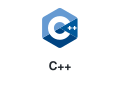
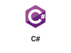
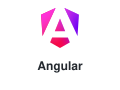
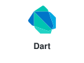
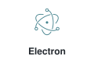
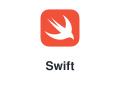
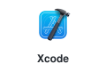
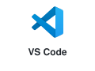

# 🎨 Tech Stack Cards Collection

| &nbsp; | 
Language
 | 
Framework / Platform
 |
| :--- | :--- | :--- |
| **C Family** |    |  |
| **Java** |  |  |
| **Python** |  |    |
| **PHP** |  |    |
| **Go** |  | 
—
 |
| **Rust** |  | 
—
 |
| **Web** |     |          |
| **Cross-Platform** |  |    |
| **Native Mobile** |   |   |
| **Database** |     |    |
| **Cloud** | 
—
 |      |
| **Developer Tools** | 
—
 |      |
| **IDE / Editor** | 
—
 |        |
| **AI** | 
—
 |       |